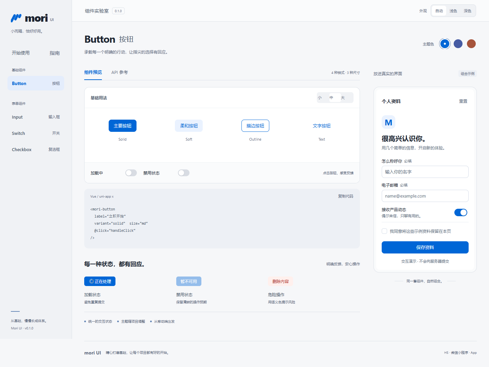
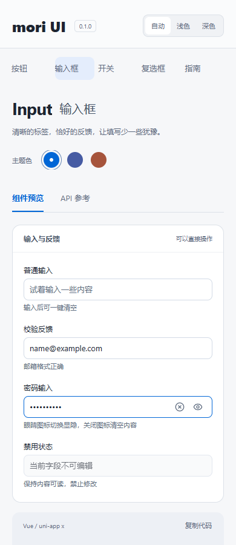
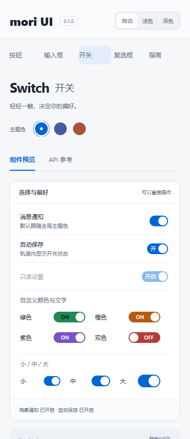

<p align="center">
  <picture>
    <source media="(prefers-color-scheme: dark) and (max-width: 600px)" srcset="docs/assets/readme/cover-mobile-dark.svg">
    <source media="(max-width: 600px)" srcset="docs/assets/readme/cover-mobile-light.svg">
    <source media="(prefers-color-scheme: dark)" srcset="docs/assets/readme/cover-dark.svg">
    
  </picture>
</p>

<p align="center">
  <strong>从一个按钮，到每一次恰好的交互。</strong><br>
  基于 uni-app x 的移动端组件库，为自己的每一个项目打好基础。
</p>

<p align="center">
  <a href="https://doc.dcloud.net.cn/uni-app-x/"></a>
  <a href="package.json"></a>
  <a href="docs/progress.md"></a>
</p>

<p align="center">
  <a href="#快速开始">快速开始</a> ·
  <a href="#组件一览">组件一览</a> ·
  <a href="#主题随你">主题配置</a>
</p>

## 好用，藏在细节里

**Mori UI** 偏爱清晰的蓝色、安静的灰阶和熟悉的系统字体。以 Apple 风格为设计参考，把空间留给内容，让输入、选择和确认各有分寸。

- **紧凑的尺寸** — 按钮与输入默认 **36px** 高，控件文字 **13px**，小圆角收住边界。
- **连贯的反馈** — 开关 **180ms** 平移，复选框 **160ms** 渐变；切换状态保持尺寸稳定。
- **自然的主题** — 默认跟随系统或宿主；全局固定浅色、深色，也能随时恢复自动。

输入框始终是一条闭合边框，显隐和清空使用图标。Switch 可分别设置开关颜色，也能在轨道里显示状态文字。H5 尊重系统的“减少动态效果”偏好。

## 先看一眼

真实 H5 工作台截图。组件预览、API 参考和组合表单放在一起，边看边试。

<picture>
  <source media="(prefers-color-scheme: dark)" srcset="docs/assets/readme/workbench-dark.png">
  
</picture>

封面与工作台预览随浏览器的浅深色偏好切换。也可以分别查看 [浅色原图](docs/assets/readme/workbench-light.png) / [深色原图](docs/assets/readme/workbench-dark.png)。

<details>
<summary><strong>展开查看移动端：输入与选择</strong></summary>

<p>390px 视口的 H5 截图，截取顶部区域展示控件细节。</p>
<p align="center">
  <a href="docs/assets/readme/mobile-input.png"></a>
  <a href="docs/assets/readme/mobile-switch.png"></a>
</p>

截图展示的是浏览器运行效果；各平台实际验证范围见下方兼容表。

</details>

## 组件一览

已提供 **72 个组件**，每个都有 [独立详细使用指南](docs/component-guides.md)，覆盖属性、事件、方法、示例和边界。下面是原有基础；新增组件可在工作台的「组件全览」直接体验。

| 组件 | 已实现的能力 | API |
| :--- | :--- | :--- |
| **Button** 按钮 | 实心 / 柔和 / 描边 / 文字，三种尺寸，加载、禁用、自定义颜色 | [mori-button](docs/components.md#mori-button) |
| **Input** 输入框 | 双向绑定、校验反馈、图标清空、密码显隐、前缀、三种尺寸 | [mori-input](docs/components.md#mori-input) |
| **Switch** 开关 | 独立开关颜色、轨道文字、三种尺寸、平滑过渡 | [mori-switch](docs/components.md#mori-switch) |
| **Checkbox** 复选框 | 自绘圆角方框、整行点选、禁用、选中动画 | [mori-checkbox](docs/components.md#mori-checkbox) |
| **Form** 表单 | 同步规则校验、分字段校验、清除错误 | [mori-form](docs/components.md#mori-form) |
| **FormItem** 表单项 | 标签、必填、错误信息与无障碍关联 | [mori-form-item](docs/components.md#mori-form-item) |
| **Radio** 单选框 | 选中与禁用、自绘状态 | [mori-radio](docs/components.md#mori-radio) |
| **RadioGroup** 单选组 | 统一模型、键盘切换 | [mori-radio-group](docs/components.md#mori-radio-group) |
| **CheckboxGroup** 多选组 | 数组模型、选择数量限制 | [mori-checkbox-group](docs/components.md#mori-checkbox-group) |
| **Textarea** 多行输入 | 长度限制、字数统计、表单错误关联 | [mori-textarea](docs/components.md#mori-textarea) |
| **Toast** 轻提示 | 文字、成功、失败、加载与计时替换 | [mori-toast](docs/components.md#mori-toast) |
| **Popup** 弹出层 | 五方向、嵌套、滑入淡入、H5 焦点和滚动管理 | [mori-popup](docs/components.md#mori-popup) |
| **Dialog** 对话框 | 确认、取消与异步等待防重复 | [mori-dialog](docs/components.md#mori-dialog) |

通过 `uni_modules` 整包复用，组件按 easycom 规则自动导入。当前是 **uni-app x / `.uvue` / UTS** 工程。

| 新增分类 | 组件与用法 |
| :--- | :--- |
| 基础与展示 | [Text](docs/components/text.md)、[Icon](docs/components/icon.md)、[Loading](docs/components/loading.md)、[Transition](docs/components/transition.md)、[Divider](docs/components/divider.md)、[Cell](docs/components/cell.md)、[Tag](docs/components/tag.md)、[Badge](docs/components/badge.md)、[Progress](docs/components/progress.md)、[Skeleton](docs/components/skeleton.md)、[Empty](docs/components/empty.md)、[Collapse](docs/components/collapse.md) |
| 导航 | [Navbar](docs/components/navbar.md)、[Tabs](docs/components/tabs.md)、[Tabbar](docs/components/tabbar.md)、[Pagination](docs/components/pagination.md) |
| 反馈 | [ActionSheet](docs/components/action-sheet.md)、[Popover](docs/components/popover.md)、[Notify](docs/components/notify.md) |
| 录入 | [Stepper](docs/components/stepper.md)、[Slider](docs/components/slider.md)、[Rate](docs/components/rate.md)、[Search](docs/components/search.md)、[Picker](docs/components/picker.md)、[Calendar](docs/components/calendar.md)、[DatetimePicker](docs/components/datetime-picker.md)、[Upload](docs/components/upload.md) |

上传具备图片选择、预览、进度、重试和主动提交，服务端由业务配置。iOS 权限、临时路径、HEIC 和后台任务等差异已在代码中编号并记录于 [平台适配跟踪](docs/platform-adaptation.md)，尚无原生设备验收。

## 快速开始

准备 **Node.js 22.13+**、**HBuilderX 及其 Vue3 编译器插件**。本轮 Windows 验证使用 HBuilderX 5.34，具体版本及历史 macOS 记录见 [兼容记录](docs/compatibility.md)。App 蒸汽模式建议 5.31+。

```sh
git clone https://github.com/xxxwonking/Mori.git
cd Mori
npm ci
npm run dev
```

打开终端显示的地址，默认请求 `http://127.0.0.1:5173`。

<details>
<summary><strong>找不到 HBuilderX？</strong></summary>

脚本自动查找 Windows 的 `D:\HBuilderX`、`C:\HBuilderX`，以及 macOS 的默认安装目录。自定义安装位置可设置环境变量：

```powershell
# Windows PowerShell
$env:HBUILDERX_HOME = 'D:\HBuilderX'
npm run dev
```

```sh
# macOS shell
export HBUILDERX_HOME='/Applications/HBuilderX.app/Contents/HBuilderX'
npm run dev
```

也可以直接在 HBuilderX 中导入仓库根目录，通过「运行」菜单选择浏览器、小程序或手机。App 的运行与打包目前通过 HBuilderX 操作。

</details>

### 体验组合示例

从工作台进入「表单基础」「反馈组件」或「组件全览」，也可访问：

- `http://127.0.0.1:5173/#/pages/forms/forms`：必填校验、单选、多选、多行输入与本地提交。
- `http://127.0.0.1:5173/#/pages/feedback/feedback`：Toast、不同位置与嵌套 Popup、确认及等待中的 Dialog。
- `http://127.0.0.1:5173/#/pages/catalog/catalog`：展示与动画、导航、反馈、数值与日期选择、图片选择和预览。

端口以终端实际输出为准。接入代码见 [使用手册](docs/user-guide.md)。

### 放进你的项目

将 [`uni_modules/mori-ui`](uni_modules/mori-ui) **整个目录**复制到目标 uni-app x 项目的 `uni_modules` 中，保留校验、选择、反馈与弹层逻辑，以及样式、平台适配、图标和许可文件。

在目标 `App.uvue` 的启动回调中初始化主题：

```vue
<script setup lang="uts">
import { initMoriTheme } from '@/uni_modules/mori-ui/theme.uts'

onLaunch(() => {
  initMoriTheme()
})
</script>
```

将这些字段合并到目标 `manifest.json`，保留项目原有配置与 AppID：

```json
{
  "uni-app-x": { "vapor": true },
  "app": { "defaultAppTheme": "auto" },
  "web": { "darkmode": true },
  "mp-weixin": { "darkmode": true }
}
```

接下来，在页面里直接使用：

```vue
<template>
  <view class="settings">
    <view class="settings-field">
      <mori-input v-model="name" label="你的名字" placeholder="怎么称呼你？" clearable />
    </view>
    <mori-switch v-model="notifications" label="消息通知"
      active-text="开启" inactive-text="关闭" />
    <mori-checkbox v-model="accepted" label="我已阅读使用说明" />
    <mori-button label="继续" :disabled="!accepted" block @click="submit" />
  </view>
</template>

<script setup lang="uts">
import { ref } from 'vue'

const name = ref('')
const notifications = ref(true)
const accepted = ref(false)

function submit() {
  uni.showToast({ title: '你好，' + (name.value.trim() || '朋友'), icon: 'none' })
}
</script>

<style>
.settings { padding: 16px; }
.settings-field { margin-bottom: 12px; }
</style>
```

这个示例只展示交互，不发送数据。页面背景和原生导航栏的主题适配参考 [`theme.json`](theme.json) / [`pages.json`](pages.json)；完整接入与校验示例见 [使用手册](docs/user-guide.md)。

## 主题，随你

默认 `auto`，跟随系统或宿主。一个配置项，就能固定全局主题：

```ts
import { setMoriConfig } from '@/uni_modules/mori-ui/theme.uts'

setMoriConfig({ theme: 'dark' })  // 固定深色，停止自动跟随
setMoriConfig({ theme: 'light' }) // 固定浅色，停止自动跟随
setMoriConfig({ theme: 'auto' })  // 恢复跟随，立即采用当前系统 / 宿主主题
```

也可以同时定义浅色与深色品牌色，更新所有组件：

```ts
setMoriConfig({
  color: '#0066d6',
  darkColor: '#8cb6ff',
  softColor: '#eaf2ff',
  darkSoftColor: '#243450'
})
```

Switch 的开启色、关闭色与文字可以单独设置。下面使用 `moriIsDark` 为两套主题分别配色：

```vue
<template>
  <mori-switch v-model="enabled" label="同步设置"
    :active-color="moriIsDark ? '#b1bfff' : '#465ba3'"
    :inactive-color="moriIsDark ? '#444b58' : '#d8dce3'"
    active-text="开启" inactive-text="关闭" />
</template>

<script setup lang="uts">
import { ref } from 'vue'
import { moriIsDark } from '@/uni_modules/mori-ui/theme.uts'

const enabled = ref(true)
</script>
```

配置只更新传入项；需要记住用户选择时，由业务保存。实例颜色优先于全局配置。系统键盘与系统选择器由平台控制。更多边界见 [主题接口](docs/components.md#主题接口)。

## 一份组件，多端打磨

当前版本 **0.1.0，开发中**。以下记录截至 **2026-10-30**；完整证据见 [兼容记录](docs/compatibility.md)。

| 平台 | 构建进度 | 运行进度 |
| :--- | :--- | :--- |
| **H5** | 发行构建通过 | Chromium 交互与布局已验证，Safari 待验证 |
| **微信小程序** | 发行构建通过 | 开发者工具与真机待验证 |
| **Android App** | 已配置蒸汽模式，原生编译待验证 | 真机待验证 |
| **iOS App** | 已配置蒸汽模式，原生编译待验证 | 真机待验证 |
| **HarmonyOS NEXT** | 工具链待配置 | 按组件尽力支持，尚未验证 |

基础组件的 H5 记录覆盖 **9 组功能检查**与 **5 项动画检查**，布局覆盖 360–1440px 的六档视口。新增表单与反馈组件另有专用回归，最新 Chrome 证据覆盖校验、选择、Toast 生命周期、嵌套弹层、焦点与滚动管理，以及底部滑入淡入的实际坐标。编译、浏览器与真机分别记录。项目 AppID、签名需要使用方配置；当前尚未发布 npm 包、插件市场包或 Release。

## 开发与验证

| 命令 | 用途 |
| :--- | :--- |
| `npm run dev` | 启动 H5 开发服务器 |
| `npm run build:h5` | H5 发行构建 |
| `npm run build:weixin` | 微信小程序发行构建 |
| `npm run preview` | 预览已构建的 H5 产物 |
| `npm run check` | 配置、easycom 目录与浏览器依赖边界检查 |
| `npm run check:docs` | 72 份组件指南的示例属性／事件与本地链接检查 |
| `npm run test:unit` | 颜色、校验、选择、日历时间、上传与反馈生命周期、构建环境回归 |
| `npm test` | 浏览器交互与布局检查 |
| `npm run test:motion` | 动画中间帧、快速反向切换与减少动态效果检查 |
| `npm run test:forms` | 表单校验、选择组、多行输入和主题交互 |
| `npm run test:feedback` | Toast 计时、弹层方向与淡入、焦点和 Dialog 交互 |
| `npm run test:catalog` | 新增组件交互、快速数值编辑、日期、真实选图、主题与布局 |

浏览器测试需先完成 H5 构建，并在另一个终端保持 `npm run preview` 运行。首次使用 Playwright 时执行 `npx playwright install chromium`。具体步骤见 [验证与排障](docs/testing.md)。

<details>
<summary><strong>查看项目结构</strong></summary>

```text
Mori/
├── uni_modules/mori-ui/    # 可复用组件库
│   ├── components/        # 七十二个基础、展示、导航、表单与反馈组件
│   ├── styles/            # 尺寸与间距基础
│   ├── platform/          # 平台适配
│   ├── static/icons/      # 随包分发的 SVG 图标
│   └── theme.uts          # 主题、语义颜色与全局配置
├── pages/index/           # 组件工作台
├── pages/forms/           # 表单基础示例
├── pages/feedback/        # Toast、Popup、Dialog 示例
├── pages/catalog/         # 新增组件分类体验页
├── components/demo-form/  # 可操作的组合示例
├── scripts/               # 开发、构建、预览与验证
├── tests/                 # 颜色、表单、选择、反馈与构建环境回归
├── docs/                  # 使用、架构、进度与兼容说明
├── AGENTS.md              # Agent 接手入口
└── DESIGN.md              # 设计规范
```

</details>

## 接下来，慢慢长成体系

- [x] Button / Input / Switch / Checkbox 基础组件
- [x] 系统主题跟随、全局覆盖与浅深品牌色
- [x] 紧凑尺寸、图标操作与选择态过渡
- [x] H5 工作台、组合表单、基础验证与接手文档
- [ ] 微信运行、iOS / Android 与 Safari 实际验证
- [x] Form / FormItem、Radio / RadioGroup、CheckboxGroup、Textarea
- [x] Toast / Popup / Dialog 与反馈示例
- [x] 展示与动画、导航分页、ActionSheet / Popover / Notify、日期时间与图片上传
- [x] 72 份逐组件用法、参数/事件/方法与平台适配跟踪
- [ ] 鸿蒙工具链与逐组件验证、分发方式和最低系统版本

后续清单是候选方向，按项目需要逐步推进。详细记录见 [当前进度](docs/progress.md)。

## 文档地图

| 想了解什么 | 从这里开始 |
| :--- | :--- |
| 怎么接入、怎么用 | [使用手册](docs/user-guide.md) · [组件 API](docs/components.md) |
| 每个组件的详细用法 | [72 份组件指南](docs/component-guides.md) |
| iOS 上传与跨端跟进 | [平台适配清单](docs/platform-adaptation.md) |
| 为什么长这样 | [设计规范](DESIGN.md) · [设计参考](docs/design-references.md) |
| 代码放在哪里、怎么维护 | [架构说明](docs/architecture.md) · [验证与排障](docs/testing.md) |
| 哪些已经完成 | [当前进度](docs/progress.md) · [兼容记录](docs/compatibility.md) |
| 让下一位 Agent 继续 | [AGENTS.md](AGENTS.md) · [交接说明](docs/agent-handoff.md) |

## 参考与致谢

基于 [uni-app x](https://doc.dcloud.net.cn/uni-app-x/) 和 [Vue](https://vuejs.org/) 构建；交互设计参考 [Vant](https://vant-ui.github.io/vant/) 与 [Wot Design Uni](https://wot-design-uni.cn/)。输入与选择图标来自 [Lucide](https://lucide.dev/)，授权说明随模块保存在 [THIRD_PARTY_NOTICES.md](uni_modules/mori-ui/THIRD_PARTY_NOTICES.md)。

<p align="center"><sub>Mori UI · 把基础打磨好，让每个项目都有好的开始。</sub></p>
